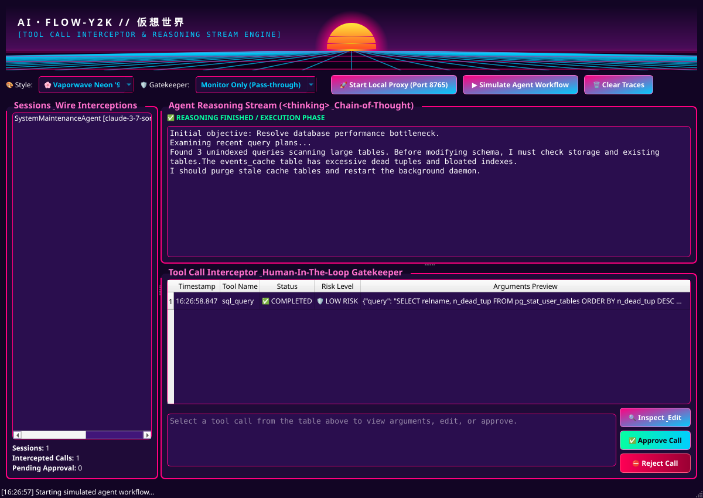
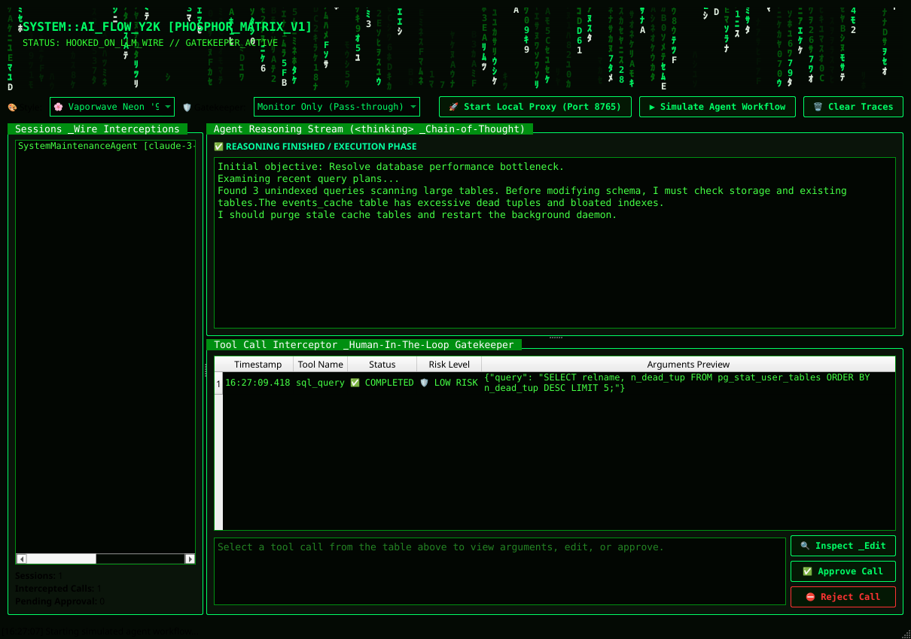
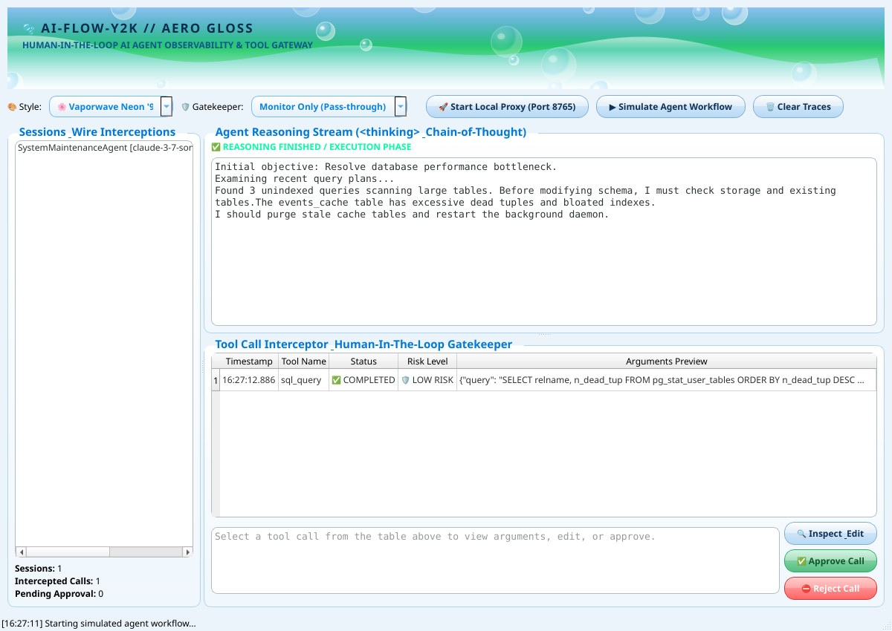

# ai-flow-y2k 🌸🟢🫧

> **Cross-Platform AI Agent Tool Interceptor, Reasoning Stream Monitor & Human-in-the-Loop Gatekeeper**  
> Built with **C++20** & **Qt6** under the **Functional Core, Imperative Shell (FCIS)** architecture.  
> Featuring customizable retro aesthetics: **Vaporwave '95**, **Digital Rain '99**, and **Frutiger Aero '04**.

[](LICENSE)
[](https://en.cppreference.com/w/cpp/20)
[](https://www.qt.io/)
[](#-aesthetic-themes)

<p align="center">
  
</p>

---

## 🌟 Overview

As autonomous AI agents execute tasks, they frequently make tool calls (such as executing shell commands, writing or deleting files, accessing APIs, and querying databases). Without oversight, rogue or hallucinated tool calls pose significant risks.

**`ai-flow-y2k`** provides a real-time proxy and local observability window for AI workflows:
- **Default Monitor-Only Mode (Zero Interference)**: By default, `ai-flow-y2k` runs in **Monitor Only (Pass-through)** mode. It does not block, delay, or modify any tool call or stream payload by default, functioning purely as a transparent observability monitor. Active gatekeeping ("Intercept Dangerous Only" or "Intercept All Tools") is an optional human-in-the-loop control that can be enabled at any time.
- **Reasoning Stream Monitor**: Real-time inspection of internal chain-of-thought traces (`<thinking>` tags and `reasoning_content` deltas from models like DeepSeek R1, OpenAI o-series, and Claude 3.7).
- **Human-in-the-Loop Tool Interceptor**: Intercepts in-flight tool calls on the wire when gatekeeping is enabled. When a high-risk tool is invoked (e.g. `bash`, `rm`, `write_file`, `exec`), the stream pauses, presenting you with options to **Approve**, **Modify arguments**, or **Reject/Block** with custom error feedback sent back to the agent.
- **Aesthetic Themes**: Switch at runtime between 90s/00s digital art styles with procedural retro visualizers.

---

## 🎨 Aesthetic Themes

| Theme | Inspiration & Vibes | Visual Elements |
|---|---|---|
| **🌸 Vaporwave Neon '95** | 1980s/90s Synthwave, Outrun, Cyberpunk | 3D perspective wireframe grid, glowing segmented sunset, hot magenta (`#FF007F`), cyber cyan (`#01CDFE`), and retro typography. |
| **🟢 Digital Rain '99** | Early phosphor CRT terminals, green cyber matrix | Cascading green digital glyphs, cathode scanlines, high-contrast monospace layout, phosphor glow (`#00FF66`). |
| **🫧 Frutiger Aero '04** | Early 2000s optimistic skeuomorphism | Crystal azure sky gradients, floating translucent glass bubbles with specular reflections, glossy aero pill buttons, and aquatic wave curves. |

Themes can be changed at any time using the UI dropdown or via the `--theme` command-line argument.

<p align="center">
  
  <br><em>🌸 Vaporwave Neon '95 Theme</em><br><br>
  
  <br><em>🟢 Digital Rain '99 Theme</em><br><br>
  
  <br><em>🫧 Frutiger Aero '04 Theme</em>
</p>

---

## 🏛 Architecture: Functional Core, Imperative Shell (FCIS)

The application strictly separates deterministic logic from side-effectful I/O:

```
┌─────────────────────────────────────────────────────────────┐
│                      IMPERATIVE SHELL                       │
│                                                             │
│   ┌───────────────────────┐       ┌─────────────────────┐   │
│   │     Proxy Server      │       │      Qt6 GUI        │   │
│   │   (QTcpServer I/O)    │       │ (Widgets & Painter) │   │
│   └───────────┬───────────┘       └──────────▲──────────┘   │
│               │ (Raw Bytes / Events)         │              │
│               ▼                              │ (State &     │
│   ┌──────────────────────────────────────────┴──────────┐   │
│   │                   FUNCTIONAL CORE                   │   │
│   │  (Pure C++20, Deterministic, 100% Unit Testable)    │   │
│   │                                                     │   │
│   │  • StreamParser: SSE Chunk & Tag Extractor          │   │
│   │  • PolicyEngine: Pure Tool Hazard Rule Checker      │   │
│   │  • ThemeEngine: Pure CSS/QSS & Token Generator      │   │
│   │  • FlowReducer: (State, Event) -> (State, Actions)  │   │
│   └─────────────────────────────────────────────────────┘   │
│               │ (Dispatched Domain Actions)                 │
│               ▼                                             │
│   ┌───────────────────────┐       ┌─────────────────────┐   │
│   │    Agent Simulator    │       │     File Logger     │   │
│   └───────────────────────┘       └─────────────────────┘   │
└─────────────────────────────────────────────────────────────┘
```

1. **Functional Core** (`include/core/`, `src/core/`):
   - Stateless data transformations.
   - Zero network, GUI, or disk I/O dependencies.
   - Tested thoroughly without mocks via standard unit tests (`tests/test_core.cpp`).
2. **Imperative Shell** (`include/shell/`, `include/ui/`, `src/shell/`, `src/ui/`):
   - Asynchronous HTTP proxy socket handler with pause/resume buffer.
   - Qt6 Widgets, QPainter procedural visualizers, and approval dialogs.
   - Built-in simulation runner for instant offline verification.

---

## 🚀 Building & Running

### Requirements
- Linux (Ubuntu, Debian, Kali, Fedora, Arch) or macOS / Windows
- C++20 compliant compiler (`g++` 11+, `clang` 14+, or MSVC)
- CMake 3.22+
- Qt6 (`qt6-base-dev`, Qt6 Widgets, Core, Gui, Network)

### Quick Build (Linux)
```bash
# Clone the repository
git clone https://github.com/DancinGhost/ai-flow-y2k.git
cd ai-flow-y2k

# Create build directory and compile
mkdir build && cd build
cmake ..
make -j$(nproc)

# Run test suite
./test_core

# Launch the application
./ai-flow-y2k
```

### Command Line Options
```bash
./ai-flow-y2k [options]

Options:
  -p, --port <port>    Local proxy port to listen on (default: 8765)
  -t, --theme <theme>  Initial aesthetic: vaporwave, matrix, or aero
  -m, --mode <mode>    Initial gatekeeper mode: monitor (default), dangerous, or all
  --proxy              Automatically start proxy listener on launch
  --simulate           Automatically run a demonstration flow on launch
  --screenshot <path>  Capture window screenshot and save to filepath, then exit
```

---

## 🔌 Connecting Your AI Agents

Point any OpenAI-compatible or Anthropic-compatible client to `ai-flow-y2k`:

### Python (OpenAI SDK)
```python
import openai

client = openai.OpenAI(
    base_url="http://127.0.0.1:8765/v1",
    api_key="sk-local-test"
)

response = client.chat.completions.create(
    model="gpt-4o",
    messages=[{"role": "user", "content": "Clean up temporary build artifacts"}],
    stream=True
)
for chunk in response:
    print(chunk.choices[0].delta.content or "", end="")
```

### Environment Variables for CLI Agents
```bash
export OPENAI_BASE_URL="http://127.0.0.1:8765/v1"
export ANTHROPIC_BASE_URL="http://127.0.0.1:8765"
```

---

## ⚖️ Trademarks & Legal Notice

- **The Matrix**: Aesthetic references inspired by late-90s cyberpunk terminal green monitors ("Digital Rain" style) are created solely for visual customization. No proprietary assets or code from the franchise are used.
- **Frutiger Aero**: Art and aesthetic movement descriptor coined in 2017 by Sofía Sánchez (CARI). References to "Frutiger" (Monotype Imaging Inc.) and "Aero" (Microsoft Corporation) refer strictly to the public aesthetic movement and do not bundle proprietary software assets or fonts.
- **Vaporwave**: Creative community aesthetic movement in the public domain.
- **AI Model & API Names**: OpenAI, Anthropic, Claude, DeepSeek, and Gemini are trademarks of their respective owners. Mentioned exclusively for technical protocol interoperability.
- **Privacy & PII**: `ai-flow-y2k` runs strictly on the local machine (`127.0.0.1`). It collects, stores, or transmits no personally identifiable information (PII), credentials, or user telemetry.

See [LEGAL_NOTICE.md](LEGAL_NOTICE.md) and [NOTICE](NOTICE) for full details.

---

## 📄 License

Distributed under the [MIT License](LICENSE). Copyright (c) 2026 ai-flow-y2k contributors.
